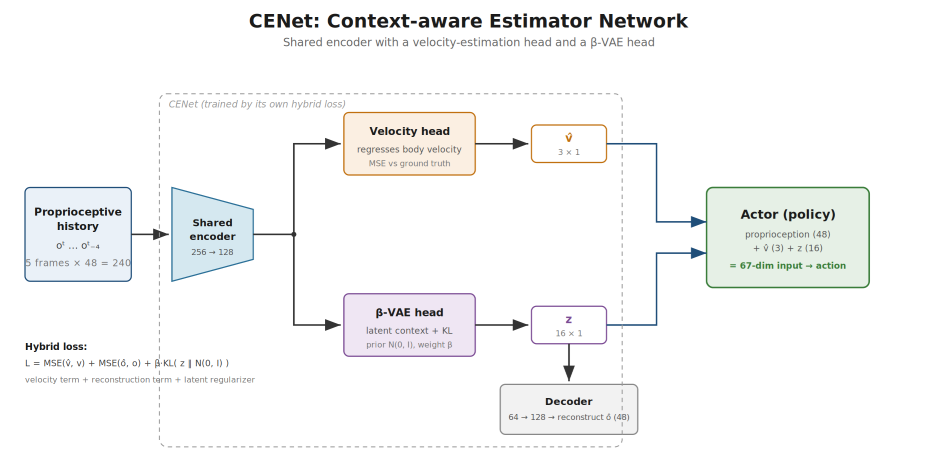
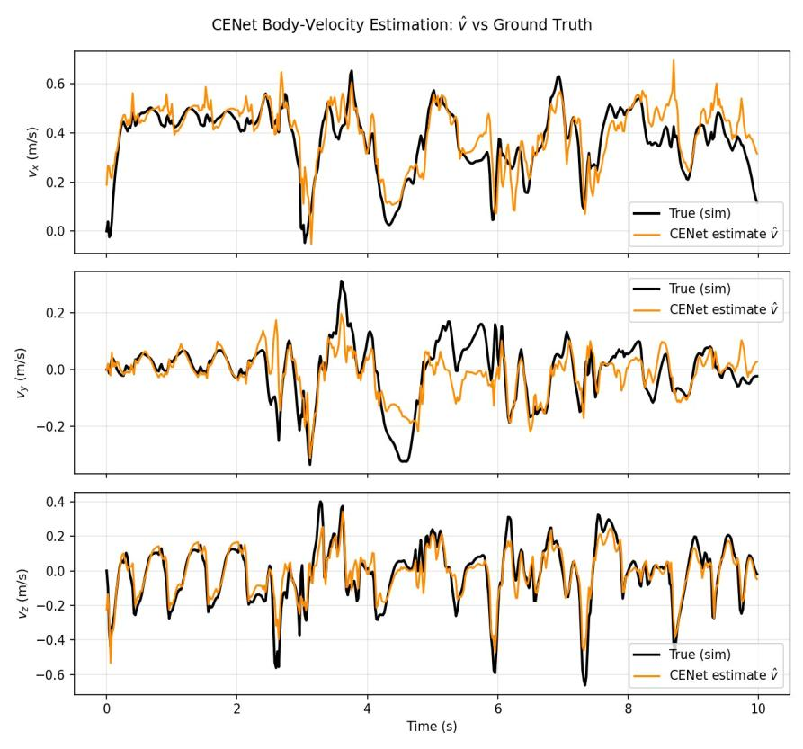
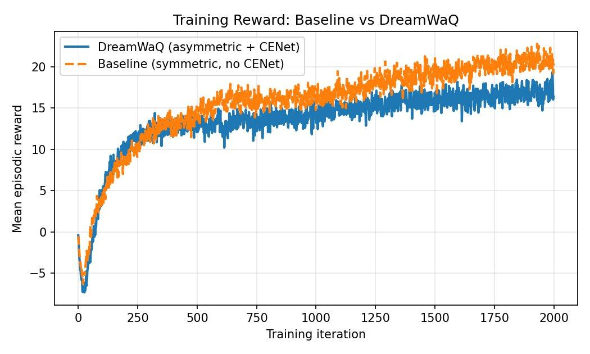
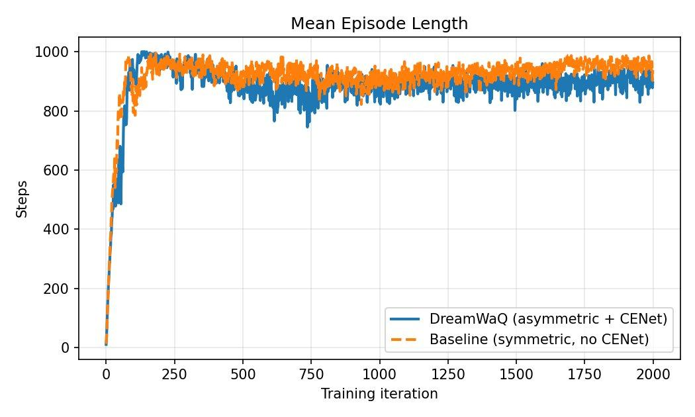
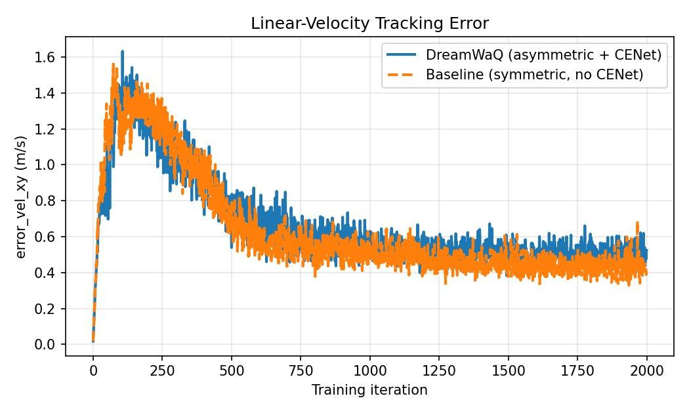
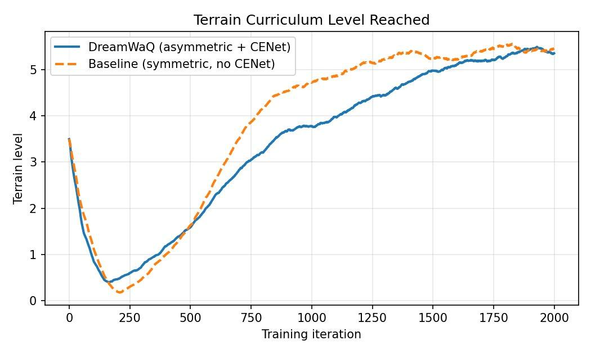
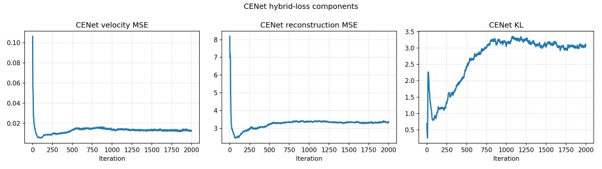
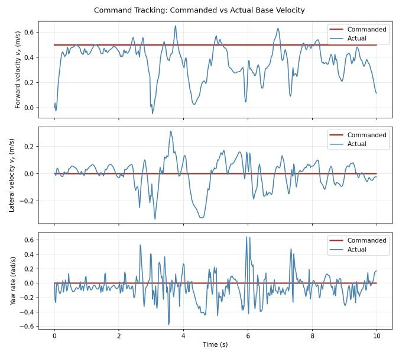
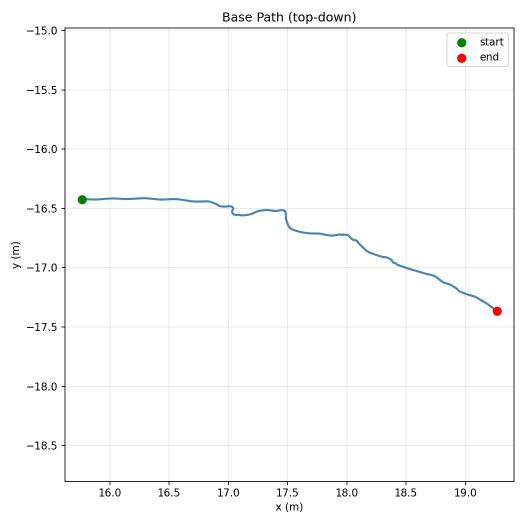
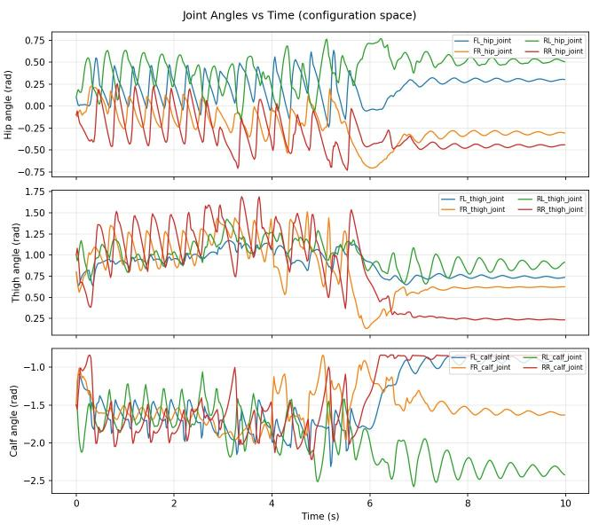

# DreamWaQ in Isaac Lab - Unitree Go2

A reproduction of the two core contributions of **DreamWaQ** (Nahrendra, Yu & Myung, ICRA 2023) in NVIDIA Isaac Lab on a Unitree Go2: an **asymmetric actor-critic** and **CENet**, a context-aided estimator that lets the deployed policy run on proprioception alone.

**Result:** the proprioception-only policy matched a privileged baseline on terrain difficulty and episode length, trailing it by ~3 reward and ~0.1 m/s tracking error. CENet recovered true body velocity to **MSE ≈ 0.006 (m/s)²** from proprioceptive history alone.

https://github.com/user-attachments/assets/daabeb17-dc1e-4bb3-8c0d-82a0601c9b6a

*Trained Go2 robots crossing discrete-obstacle terrain in Isaac Sim, each tracking its own velocity command.*

---

## The problem

In simulation an RL policy can see privileged information - the exact terrain under the robot, its true base velocity. A real quadruped has neither. It has joint encoders and an IMU. So a policy trained on privileged inputs cannot be deployed.

DreamWaQ's answer is to have the robot infer that hidden state from its own recent proprioceptive history, and to train the policy, the value function, and the estimator **together in a single phase** - no teacher-student distillation.

## Method

**Asymmetric actor-critic.** The actor sees only what hardware can measure (45-D proprioception) plus CENet's outputs. The critic, used only during training, additionally sees a 187-D terrain height scan and the true base velocity.

| Group | Dim | Contents | Seen by |
|---|---|---|---|
| `policy` | 45 | ang. velocity, gravity, command, joint pos/vel, last action | actor + critic |
| `height_scan` | 187 | 17×11 terrain height grid (privileged) | critic only |
| `privileged_vel` | 3 | true base linear velocity | critic + CENet target |

Actor input **64** (45 + 3 velocity + 16 latent) · Critic input **235** (45 + 187 + 3)

**CENet.** A shared encoder over the last 5 proprioceptive frames (225-D) splits into two heads: a velocity head regressing 3-D body velocity, and a β-VAE head producing a 16-D latent context. Trained with a hybrid loss:

```
L = MSE(v̂, v) + MSE(ô, o) + β · KL( z ‖ N(0, I) )
```

CENet's outputs are **detached** before reaching the actor, so the policy's gradient cannot reshape the estimator - it learns only from its own prediction error.



## Results

Both policies: 2000 iterations, seed 1, identical curriculum and rewards. The only differences are observation routing and the CENet loss.

| Metric | Baseline (privileged) | DreamWaQ |
|---|---|---|
| Mean episodic reward | 20.0 | 17.0 |
| Mean episode length | 940 | 915 |
| Linear-velocity error (m/s) | 0.41 | 0.50 |
| Terrain curriculum level | 5.46 | 5.35 |
| CENet velocity MSE | - | 0.012 (train) / 0.0058 (eval) |
| **Actor observation dim** | **235 (privileged)** | **64 (deployable)** |

The last row is the point. Near-equal locomotion from a quarter of the observations, none of them privileged.

### CENet velocity estimation



The estimate (orange) tracks true body velocity (black) on all three axes, including the rapid vertical swings as the body bounces during walking - from proprioceptive history alone. This is what makes the proprioception-only policy work.

### Training curves

| Reward | Episode length |
|---|---|
|  |  |

| Velocity tracking error | Terrain curriculum |
|---|---|
|  |  |

The curves track closely for ~400 iterations, after which the baseline holds a steady lead of roughly three reward points - the expected cost of replacing privileged inputs with inferred state. Both finish at essentially the same terrain level (5.46 vs 5.35).



Velocity MSE drops from ~0.10 to ~0.01 within the first hundred iterations. The KL term rises and levels off around 3.0–3.1 rather than collapsing to the prior, so the latent stays active and keeps carrying information.

### Evaluation rollout

| Command tracking | Base path (top-down) | Joint angles |
|---|---|---|
|  |  |  |

## Setup

Requires NVIDIA Isaac Lab 2.0 (Isaac Sim 4.5) and `rsl_rl` 3.1.2. Trained on a single RTX 4060 Laptop (8 GB), 2048 parallel envs at ~11–13k steps/s.

```bash
# copy the task package into Isaac Lab's locomotion config folder
cp -r go2_dreamwaq \
  source/isaaclab_tasks/isaaclab_tasks/manager_based/locomotion/velocity/config/
```

Task IDs register automatically on import. No framework files are modified.

```bash
# baseline (privileged, symmetric)
isaaclab.sh -p scripts/reinforcement_learning/rsl_rl/train.py \
  --task Isaac-Velocity-Rough-Unitree-Go2-v0 --headless --max_iterations 2000 --seed 1

# DreamWaQ (asymmetric + CENet)
DREAMWAQ_CENET_BETA=0.5 isaaclab.sh -p scripts/reinforcement_learning/rsl_rl/train.py \
  --task Isaac-Velocity-Rough-Go2-DreamWaQ-v0 --headless --max_iterations 2000 --seed 1

# evaluate
isaaclab.sh -p scripts/rollout_eval.py \
  --task Isaac-Velocity-Rough-Go2-DreamWaQ-Play-v0 --num_envs 1 --num_steps 500 --out ./figures
```

## IsaacLab fast soil proxy (local installation)

`soft-train`, `soft-play`, `soft-eval` and `soft-check` retain PhysX and the
original DreamWaQ model, PPO settings, observation dimensions, action scaling and
reward functions. The separate task initially uses **flat** soil: normal bearing,
horizontal drag, shin/thigh resistance, pull-out resistance and footprint memory
come from [newton-terrain's sand proxy](https://github.com/prakash-aryan/newton-terrain/blob/main/newton_terrain/sand_proxy.py).
This is an approximate force model, not MPM or a deforming terrain mesh.

The existing sibling checkout `../newton-terrain` supplies
`newton_terrain/sand_proxy.py` and `runs/proxy_table.json`; set
`NEWTON_TERRAIN_PATH` if it is elsewhere. Newton/MuJoCo need not be installed in
the `dreamwaq` environment. The adapter supports Isaac Sim's bundled Warp 1.5.
Source/table hashes and resolved coefficients are saved in each run's environment
configuration.

```bash
# Short physics/contact/reset verification; does not train.
bash scripts/isaac.sh soft-check --headless --num_envs 4 --steps 100

# Physical acceptance: no policy, original joint targets, no automatic resets.
bash scripts/isaac.sh soft-physics --headless --num_envs 4 --seconds 8
# Matched rigid control; separate diagnostic run.
bash scripts/isaac.sh soft-physics --headless --num_envs 4 --seconds 8 --rigid
# Isolate bearing under imposed geometry (diagnostic joint constraints only).
bash scripts/isaac.sh soft-physics --headless --num_envs 4 --seconds 8 --lock_joints
# Paired timestep/velocity audit; 5, 2.5 and 1.25 ms, always 20 ms control.
bash scripts/isaac.sh soft-physics --headless --num_envs 4 --seconds 8 --sweep_dt
# Extend the convergence study without changing soil or actuator parameters.
bash scripts/isaac.sh soft-physics --headless --num_envs 4 --seconds 8 \
  --sweep_dt --sweep_dts 0.000625,0.0003125

# Manual training with the migrated soil task; original learning algorithm/model.
# Material/depth defaults remain f0.75 sand and 0.15 m.
bash scripts/isaac.sh soft-train --headless --num_envs 2048 \
  --max_iterations 2000 --seed 1 --run_name sand_f075_dt03125_seed1

# Fine-tune the trained DreamWaQ rigid-ground model into a NEW soft run.
# Loads actor, critic and CENet weights; optimizer and iteration counter start fresh.
bash scripts/isaac.sh soft-train --headless --num_envs 2048 \
  --max_iterations 2000 --seed 1 --run_name soft_finetune_from_rough_seed1 \
  agent.init_checkpoint=/home/allvey/Projects/robotics/dreamwaq-isaaclab/logs/rsl_rl/isaaclab/go2_dreamwaq_rough/2026-10-18_14-35-23_clean_seed1/model_1999.pt

# Matched flat rigid control, with otherwise identical task/algorithm settings.
bash scripts/isaac.sh soft-train --headless --num_envs 2048 \
  --max_iterations 2000 --seed 1 --run_name rigid_dt03125_seed1 \
  env.scene.terrain.soft_enabled=false \
  agent.experiment_name=isaaclab/go2_dreamwaq_rigid_flat

# View an explicitly selected checkpoint; may also use an existing rigid policy.
bash scripts/isaac.sh soft-play --num_envs 4 --checkpoint /absolute/path/model_1999.pt
```

Soft runs go to `logs/rsl_rl/isaaclab/go2_dreamwaq_soft_flat/<run>/`;
the control command uses `isaaclab/go2_dreamwaq_rigid_flat/<run>/` under the same
root. Point TensorBoard at `logs/rsl_rl/`. Existing `train`, `play`, `eval` commands
still use the original rough task. Compare the soft task with the matched flat
control; historical rough-terrain runs have a different terrain distribution.
`agent.init_checkpoint` initializes a new run from network weights, with the
original PPO settings and a fresh optimizer/iteration counter. The source path is
saved in `params/agent.yaml`. Do not combine it with `--resume True`, which resumes
an existing run's optimizer and iteration state. Formal training is started manually.

The nominal surface is at z=0 with no collider; PhysX's hard bottom is at z=-depth.
Soil normal forces enter the existing contact sensor before history/air-time
updates, including base-contact termination. Height scans see the nominal top,
not footprint depressions. Memory is per environment and is cleared on reset.
Tune physical parameters with Hydra, e.g. `env.scene.terrain.depth=0.10` or
`env.scene.terrain.material=f0.9`, without changing model code.

### Mixed original rough terrain and fixed soil scenarios

`mixed-train` uses the original policy and PPO update. Half of the robots start
on the original rough terrain and half on the added soil cells by default. The
soil cells occupy the next **five +Y columns of the same grid**, with one shared
outer border. Every cell is **8 x 8 m**; its **6 x 6 m** interior is surrounded
by **1 m of flat rigid ground**, giving 2 m lanes between neighbouring interiors.
The fixed scene types, in column order, are:

| Column | Scenario | Fixed geometry |
| --- | --- | --- |
| 1 | `flat` | Flat uniform soil |
| 2 | `mound` | Smooth 0.30 m hill |
| 3 | `basin` | Smooth 0.20 m depression with walkable sides |
| 4 | `undulating` | Windowed waves, amplitude parameter 0.10 m and wavelength 2 m |
| 5 | `mixed` | Alternating 1 m soft/hard bands inside the cell |

There are 10 identical rows per type in training, or 5 in the reduced play scene.
**There is no soil curriculum or progression**: each row repeats the same fixed
profile and material (`f0.75`). The original rough-terrain curriculum is retained.
`soft_columns` selects the number of appended columns; `soft_scenarios` selects
the ordered scenario list (cycled if more columns are requested). For a flat-only
control use `env.scene.terrain.soft_columns=1` and
`'env.scene.terrain.soft_scenarios=[flat]'` during training.
`soft_fraction` still controls the number of soil-spawn robots independently of
map area. Spawn sampling cycles across all types, then rows; soil memory remains
isolated per robot. `soft_border`, `soft_resolution`, `soft_mound_height`,
`soft_basin_depth`, `soft_wave_height`, `soft_wave_length` and `soft_stripe_width`
are stored in the resolved configuration. Grid spacing defaults to 0.1 m.

The rendered top, hidden critic scan and per-contact physical sampling use the
same triangulated height grid. There is no rigid collider on a soft top: the
collision bottom follows that profile at a vertical offset of -0.15 m. Hard frames
and internal hard bands have real top colliders. The upstream spring, plastic
yield, footprint, drag and pull-out equations are evaluated in a separate local
tangent frame for each leg; forces/torques are rotated back to world coordinates.
Belly contact uses its own surface sample. This is a gently curved surface proxy,
not volumetric MPM or exact rod integration across curved/material boundaries.
Flat-patch force parity, slope support direction and tangential dissipation are
covered by `mixed-check`. The standalone flat-soil task retains its original
horizontal kernel.

Spawn groups label statistics only: robots from either group acquire soil forces
when their feet enter a soft patch. Local-origin changes from the rough curriculum
are accounted for. Original active-cell triangles are retained; only the flat
perimeter is rebuilt around the extended grid. Source/active rough mesh and soil
surface hashes are recorded. Use a new run name for this five-scenario variant.

The mixed scene now defaults to the **32-substep speed experiment**: 0.625 ms
physics, 50 Hz control and a 15 ms contact-history window (24 samples). Set
`env.scene.terrain.physics_substeps=64` to select the converged 0.3125 ms reference
(48 contact samples). This one selector resolves dt, decimation, render interval
and contact sampling together after Hydra overrides. The standalone flat soil
task retains its 64-substep default; historical original rough runs use 5 ms
physics. Both remain separate evaluation references. Earlier 32-substep standing
tests passed basic thresholds but retained high-frequency oscillation; record
this as a distinct numerical experiment rather than an equivalent replacement.
Network/CENet inputs, losses, PPO settings, rewards, commands and actuators are
unchanged. Terrain curriculum applies only to the rough group; soft origins and
per-environment soil memory remain isolated across resets.

```bash
# Acceptance only: geometry, force/contact/reset isolation and one discarded
# PPO update. No trained checkpoint is written and runner.learn is not called.
bash scripts/isaac.sh mixed-check --headless --num_envs 12 --steps 100

# Start formal training MANUALLY from the original rough checkpoint.
bash scripts/isaac.sh mixed-train --headless --num_envs 2048 \
  --max_iterations 2000 --seed 1 --run_name rough_soil_scenarios_32substeps_seed1 \
  env.scene.terrain.physics_substeps=32 \
  env.scene.terrain.soft_fraction=0.5 \
  agent.init_checkpoint=/home/allvey/Projects/robotics/dreamwaq-isaaclab/logs/rsl_rl/isaaclab/go2_dreamwaq_rough/2026-10-18_14-35-23_clean_seed1/model_1999.pt

# View the mixed task, initially following rough env 0 (at least two required).
bash scripts/isaac.sh mixed-play --num_envs 12 --checkpoint /absolute/path/model.pt
# Show the original terrain and all five soil scenario columns from above.
bash scripts/isaac.sh mixed-play --overview --num_envs 12 --checkpoint /absolute/path/model.pt

# Evaluate two legacy references (these do not cover all five soil scenarios):
# the SAME checkpoint on the historical native rough task
# and on the current flat soil, with the same fixed commands and seed.
bash scripts/isaac.sh soft-rollout --single --original_rough --headless \
  --num_envs 16 --seed 1 --phase_seconds 4 --cycles 2 \
  --checkpoint /absolute/path/model.pt
bash scripts/isaac.sh soft-rollout --single --headless \
  --num_envs 16 --seed 1 --phase_seconds 4 --cycles 2 \
  --physics_dt 0.000625 \
  --checkpoint /absolute/path/model.pt
```

Mixed checkpoints, TensorBoard events and resolved configurations are stored in
`logs/rsl_rl/isaaclab/go2_dreamwaq_mixed/<run>/`. The configuration records the
rough mesh hash and actual rounded group sizes. TensorBoard's `Mixed/` series
separate rough/soft reward per simulated second, termination/timeout fractions
per step, and the actual soft sample fraction; these are not episode success
rates. `SoilScenario/` adds the same metrics per soil spawn type.
Use `logs/rsl_rl/` as the TensorBoard root. Evaluate multiple seeds before
selecting a checkpoint; combined training reward alone can hide standing drift.
To continue an existing mixed checkpoint with optimizer state, use `--resume True
--load_run <existing-run> --checkpoint model_<iteration>.pt` and a new `--run_name`
containing `32substeps`; omit `agent.init_checkpoint`. The native runner writes a
new run directory and treats `--max_iterations` as additional iterations after
the loaded counter. Existing training processes retain their original timestep;
they are never automatically stopped or restarted.

### Separate hard/soft stages on the same complete map

`mixed-train --stage hard` and `mixed-train --stage soft` retain the ENTIRE map,
including all original rough cells and all five soil types. They change robot
sampling and physics timing, not map geometry. The default `--stage mixed` keeps
the existing simultaneous training mode.

| Stage | Robot spawn region | Physics per 20 ms control step | Soil proxy |
| --- | --- | --- | --- |
| `hard` | Original rough cells only | 4 steps at 5 ms | Disabled; native actions/contact sensor |
| `soft` | Five soil columns, including their hard lanes | 32 steps at 0.625 ms (or selected 64) | Enabled |

Hard-stage contact history retains the original three samples (15 ms); soft-stage
history retains 24/48 samples (15 ms). Network inputs, PPO, rewards and PD settings
are unchanged. Hard-stage rough curriculum remains active. Soft-stage origins
stay fixed, and no soil difficulty progression is added. `soft_fraction` applies
only to the simultaneous `mixed` stage; pure stages use 100% of their domain.

A boundary timeout resets a robot as its body links approach within 0.6 m of the
stage region boundary. It is a truncation with the existing RSL-RL timeout
bootstrap, not a fall/success reward. Reset and rough curriculum remain confined
to the selected domain. `Stage/boundary_fraction` reports these events separately.
The complete mesh remains loaded, so speed gains must be measured, particularly
for the soft stage. There is no automatic stage scheduler or in-process timestep
switch: finish/checkpoint one manual run, then manually start the next one.

For example, warm-start a new soft-stage run from the original rough weights:

```bash
bash scripts/isaac.sh mixed-train --stage soft --headless --num_envs 2048 \
  --max_iterations 100 --seed 1 --run_name stage_soft_seed1 \
  env.scene.terrain.physics_substeps=32 \
  agent.init_checkpoint=logs/rsl_rl/isaaclab/go2_dreamwaq_rough/2026-10-18_14-35-23_clean_seed1/model_1999.pt
```

To continue into the hard stage, preserving model, optimizer and iteration state:

```bash
bash scripts/isaac.sh mixed-train --stage hard --headless --num_envs 2048 \
  --max_iterations 100 --seed 1 --run_name stage_hard_seed1 \
  --resume True --load_run <previous-soft-run-folder> --checkpoint <model_N.pt>
```

Then use `--stage soft` and the hard run's checkpoint for the next soft stage.
With resume, `max_iterations` is the number of ADDITIONAL iterations. Do not add
`agent.init_checkpoint` when resuming. Every command creates a new timestamped
run under `logs/rsl_rl/isaaclab/go2_dreamwaq_mixed/`, keeping previous results.
The 100-iteration blocks are an example, not a validated optimal stage schedule.

Stage choice also works with play; its CLI is `--stage hard` or `--stage soft`.
Hydra training can instead set `env.scene.terrain.training_stage=hard/soft`.
Use one stage selector consistently. Resolved `params/env.yaml` records the stage,
actual dt/decimation, boundary margin and realized group counts.

```bash
# Diagnostic acceptance only; no runner.learn or model save.
bash scripts/isaac.sh mixed-stage-check --headless --stage hard --checkpoint /absolute/path/model.pt
bash scripts/isaac.sh mixed-stage-check --headless --stage soft --substeps 32 --checkpoint /absolute/path/model.pt
# Matched inference sampling benchmarks; run sequentially on an idle GPU.
bash scripts/isaac.sh mixed-profile --headless --stage hard --num_envs 2048 --checkpoint /absolute/path/model.pt
bash scripts/isaac.sh mixed-profile --headless --stage soft --substeps 32 --num_envs 2048 --checkpoint /absolute/path/model.pt
```

### Sampling performance

Soil state preparation reuses the existing body-state buffer and the original
`quat_apply` expression for world COM positions. COM offsets are refreshed each
control step and after resets, instead of querying PhysX's CPU COM buffer twice
per physics substep. This is enabled by default for flat and mixed soil; use
`env.scene.terrain.optimized=false` with `soft-train` or `mixed-train` to select
the reference path. This computation optimization preserves whichever timing
profile was selected, the soil force kernel, network and PPO settings.

Use the same checkpoint, seed, environment count and timing counts for the pair:

```bash
bash scripts/isaac.sh mixed-profile --headless --reference \
  --num_envs 2048 --substeps 32 --steps 24 --warmup 8 --profile_steps 2 \
  --checkpoint /absolute/path/model.pt
bash scripts/isaac.sh mixed-profile --headless \
  --num_envs 2048 --substeps 32 --steps 24 --warmup 8 --profile_steps 2 \
  --checkpoint /absolute/path/model.pt
```

Run performance measurements without another simulation/training process on the
GPU. These commands run inference only, save no model and do not call the learning
loop. Each writes `summary.json`, `env.yaml` and `agent.yaml` under
`logs/rsl_rl/isaaclab/go2_dreamwaq_mixed_profile/<run>/`. Clean throughput timing
synchronizes CUDA only at block boundaries. A separate component pass synchronizes
all CUDA work around each call to include PhysX's other streams; this intentionally
changes scheduling, so component times are not normal training throughput.
Use `--substeps 64` for the earlier timing reference. When comparing 32 versus
64 substeps, omit `--reference` on both so the adapter implementation matches.

Exact trajectory/contact parity can be checked in fresh processes:

```bash
bash scripts/isaac.sh mixed-check --headless --reference --num_envs 8 --steps 100 \
  --substeps 32 \
  --record /tmp/dreamwaq_mixed_reference.npz
bash scripts/isaac.sh mixed-check --headless --num_envs 12 --steps 100 \
  --substeps 32 \
  --compare /tmp/dreamwaq_mixed_reference.npz
```

The comparison covers both groups' root/joint states, rewards and contacts, plus
soft wrenches, depth, footprint state, contact history and air time. These checks
also discard one diagnostic PPO update; they never write a trained checkpoint.
A passing short check verifies interfaces and finite physics, not locomotion
performance or calibration to real soil.

`soft-physics` checks bearing/moment balance, dissipative foot/shin/thigh drag,
pull-out resistance, footprint reuse, ring-buffer wraparound, isolated resets,
and actual PhysX force application using free-flight momentum balance. It then
measures fixed-target standing and applies the same recorded thresholds to rigid
and soft runs. Failure returns a nonzero exit code. Each new diagnostic run saves
`env.yaml`, `summary.json`, `measurements.npz` and `physics.png` under
`logs/rsl_rl/isaaclab/go2_dreamwaq_soft_physics/<run>/`.

`--physics_dt` changes only a diagnostic run's timestep and synchronizes its
decimation, rendering interval and contact sampling, retaining a 20 ms control
period and height scan interval. The sweep verifies resolved configuration and
startup-weight invariants across matched rigid/soft cases. Each case also saves
joint/foot positions, reported velocities, position-difference velocities, world
wrenches and horizontal-drag work estimates in `measurements.npz`, with a
`velocity_audit.png` figure. Configuration-based and velocity-trapezoid work
estimates are distinct diagnostics; neither alone is total-system energy balance.

Saved sweeps can be combined with `--report_sweep <sweep_dir> [<sweep_dir> ...]`;
this creates a new comparison report without rerunning physics or replacing old
results. The report includes `comparison.json` and `dt_convergence.png`. A sweep
returns nonzero if any case fails acceptance, including its deliberately retained
5 ms baseline.

The original 5 ms physics timestep passes the force-law checks but fails free-joint
standing because of persistent leg oscillation; the rigid control passes.
`--lock_joints` isolates bearing and does **not** certify free-joint stability.
Experimental `--floor_stiffness`, `--normal_damping`, `--drag_damping_cap` and
`--drag_scale` overrides are recorded per run. Trial values have not been adopted
as training defaults. The network, PPO and actuator gains remain unchanged.

The paired convergence audit (4 environments, seed 1, 8 seconds) reduced mean
joint speed from 5.24 rad/s at 5 ms to 1.16 at 2.5 ms and 0.417 at 1.25 ms.
Those cases failed the original standing criteria. At 0.625 ms the mean was
0.133 rad/s and acceptance passed, although a small two-step oscillation remained.
At 0.3125 ms it fell to 0.00348 rad/s and that oscillation disappeared; both
corresponding rigid controls also passed. The resolved timestep was the only
experimental setting varied, with dependent timing fields synchronized to
retain 50 Hz control. This supports a discrete-coupling instability diagnosis.

The migrated soft task and its matched flat rigid control default to 0.3125 ms
and 64 physics substeps per control step. `soft-train`, `soft-play`, `soft-eval`,
`soft-check` and the default `soft-physics` use this validated coupling timestep.
The original rough task keeps its original timing. For RL/play, 48
contact-history samples retain the original 15 ms window
(3 samples at 5 ms); the standalone physics audit bypasses RL rewards and
terminations. Proprioceptive history stays at 5 policy frames and 50 Hz.
Static acceptance does not establish locomotion performance, multiple-seed
robustness, or training throughput.

An optional inference-only paired rollout measures frozen-policy transfer:

```bash
bash scripts/isaac.sh soft-rollout --headless --num_envs 4 \
  --checkpoint logs/rsl_rl/isaaclab/go2_dreamwaq_rough/2026-10-18_14-35-23_clean_seed1/model_1999.pt \
  --phase_seconds 3 --cycles 2 --seeds 1,2,3
```

This runs fresh rigid/soft processes for each seed, with identical 0.3125 ms
physics, 50 Hz control, 48 contact-history samples, the original play settings,
and five command phases: stand, forward at 0.3 m/s, lateral at 0.2 m/s, turn at
0.4 rad/s, and stand again. The example repeats the schedule for 30 seconds per
case. Original episode timeouts and non-timeout termination rules remain active;
states and termination reasons are captured **before** automatic resets. Soft
resets also check footprint-memory clearing and isolation from other environments.
The original CENet samples a latent even in inference; an isolated per-step Torch
RNG gives each pair the same samples without changing the model or consuming the
environment's random stream. Checkpoint and policy hashes verify frozen weights.

Results go to `logs/rsl_rl/isaaclab/go2_dreamwaq_soft_rollout/<batch>/`, including
each case's resolved environment/agent configuration, measurements, summary and
the batch comparison plot/JSON. The report checks paired configuration, initial
poses, masses, inertias, materials, actor observations and first actions. Initial
privileged height scans allow 10 micrometres of ray-intersection rounding between
the rigid plane and visual soil mesh; these scans do not enter the actor. Native
joint positions and velocities are recorded at every physics substep so that
50 Hz sampling cannot hide fast oscillations. Tracking metrics discard the first
second of each phase; overall metrics retain every sample and every reset.
Runtime includes diagnostic recording and is not a training-throughput estimate.
Rebuild a report without repeating simulation with `soft-rollout --report <batch>`.
Reports also summarize each phase before each environment's first reset, and
separate terminations before/after the first timeout. Resume an interrupted batch
using the same command plus `--resume --out <batch>`: completed matching cases
are reused, while partial cases/logs are preserved in place and retried in new
directories. Other output directories must be new. This evaluates transfer of a rigid-trained
policy; poor soft-ground tracking alone does not establish a physics failure.

The 3-seed audit (4 environments per case, 30 seconds, frozen `model_1999.pt`)
passed configuration/initial-state parity and all 20 soft-memory reset checks.
Before the first reset, mean forward speed under a 0.3 m/s command was 0.178 m/s
on rigid ground and -0.013 m/s on soil; mean yaw rate under a 0.4 rad/s command
was 0.390 and -0.068 rad/s respectively. Both lateral responses were weak.
Neither group had a base-contact termination before its first 20-second timeout;
after timeouts there were 12 rigid and 8 soft base-contact terminations. No
pre-reset soft sample exceeded 5% body weight in hard-floor support, and the
largest phase high-frequency joint-velocity power fraction was 0.029% (top 20%
of the available frequency band). Frozen-policy tracking and post-reset recovery
are transfer observations, not pass/fail criteria for migrating the soil model.
Migration acceptance concerns force-law fidelity, PhysX wrench application,
contact feedback, numerical stability and per-environment soil-state resets.
Real-soil calibration and training throughput remain unvalidated.
The saved batch is
`logs/rsl_rl/isaaclab/go2_dreamwaq_soft_rollout/2026-10-22_23-22-45_467893_paired/`.

To measure forgetting on the original rigid rough task, evaluate each checkpoint
with the same seed and command schedule:

```bash
bash scripts/isaac.sh soft-rollout --single --original_rough --headless \
  --num_envs 16 --phase_seconds 4 --cycles 2 --seed 1 \
  --checkpoint /absolute/path/model_1999.pt
```

This selects the original `Isaac-Velocity-Rough-Go2-DreamWaQ-Play-v0` task,
including its rough terrain generator, native 5 ms physics / 50 Hz control,
3-sample contact history and clean Play observations. No soil adapter is used.
Only the evaluation command schedule replaces the random velocity commands;
the terrain mesh is seeded and hashed, and initial states/terrain assignments
are saved for checking parity across checkpoints. Native episode termination,
timeouts and terrain curriculum remain active; after resets the trajectories
and terrain levels can diverge. Results go to
`logs/rsl_rl/isaaclab/go2_dreamwaq_forgetting/<run>/`, including rewards,
completed episode lengths, termination reasons and first-failure times.
Add `--command_scale 2` to test 0.6 m/s forward, 0.4 m/s lateral and 0.8 rad/s
yaw using the same schedule; use identical scales for both checkpoints.

## Verification

Each component was gated on a pass/fail check before the next was built:

1. Stock task trains
2. Forked task trains identically - package works
3. Printed dims confirm asymmetry (actor 64, critic 235)
4. Unit tests: output shapes, finite differentiable loss, gradients reach the shared encoder from CENet's loss but **not** the actor's
5. Live run shows CENet losses decreasing

```bash
isaaclab.sh -p tests/test_cenet.py
isaaclab.sh -p tests/test_dreamwaq_actor_critic.py
```

## Repository layout

```
go2_dreamwaq/
  __init__.py                  task ID + custom class registration
  rough_env_cfg.py             env config, observation group split
  rsl_rl_ppo_cfg.py            PPO config, obs_groups routing
  cenet.py                     CENet module (encoder + 2 heads + hybrid loss)
  dreamwaq_actor_critic.py     wraps CENet around the stock policy
  dreamwaq_ppo.py              single-phase update (PPO + CENet loss)
tests/                         offline unit tests
scripts/                       plotting and rollout evaluation
docs/                          full report (PDF) and figures
```

## Full report

The complete write-up - method, implementation decisions, verification strategy, and discussion - is in [`docs/DreamWaQ_Report_Roman_Kalyna.pdf`](docs/DreamWaQ_Report_Roman_Kalyna.pdf).

## Limitations

Stated plainly, since this is a reproduction rather than a replication of the paper's numbers:

- Single seed - indicative, not statistically supported. No error bars.
- 2048 parallel envs vs the paper's 4096 (8 GB VRAM limit).
- Go2 in Isaac Lab rather than A1 in Isaac Gym.
- The AdaBoot adaptive-bootstrapping gate was not implemented.
- The VAE reconstructs the *current* observation rather than the next, to avoid modifying rollout storage.
- β fixed at 0.5 by hand - chosen because β = 1 caused posterior collapse. Not swept.
- The critic receives the height scan and true velocity but not the paper's random disturbance force, so it is slightly less privileged than the original.

## References

- I. M. A. Nahrendra, B. Yu, H. Myung, "DreamWaQ: Learning Robust Quadrupedal Locomotion With Implicit Terrain Imagination via Deep Reinforcement Learning," ICRA 2023. [arXiv:2301.10602](https://arxiv.org/abs/2301.10602)
- N. Rudin et al., "Learning to Walk in Minutes Using Massively Parallel Deep Reinforcement Learning," CoRL 2022 - the `rsl_rl` PPO implementation.
- M. Mittal et al., "Orbit: A Unified Simulation Framework for Interactive Robot Learning Environments," RA-L 2023 - predecessor of Isaac Lab.
- [Manaro-Alpha/DreamWaQ](https://github.com/Manaro-Alpha/DreamWaQ) - public reference implementation targeting Isaac Gym, consulted for network and training design.

## License

MIT - see [LICENSE](LICENSE). Depends on NVIDIA Isaac Lab (BSD-3-Clause) and `rsl_rl` (BSD-3-Clause), neither of which is vendored here.

---

**Roman Kalyna** · Mechanical Engineer, Mechatronics & Robotics
[LinkedIn](https://linkedin.com/in/roman-kalyna)
